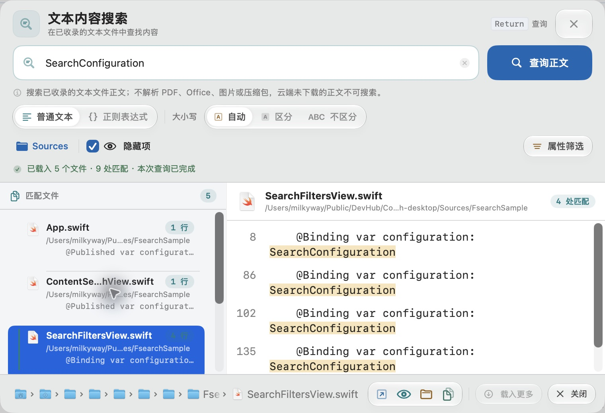
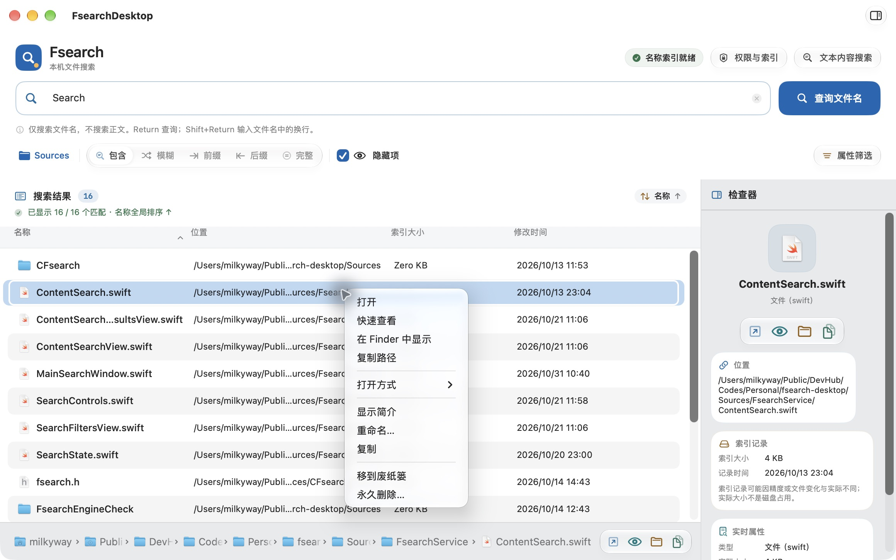

# FsearchDesktop

**在 Mac 上按文件名和文本内容查找文件。**

基于 [Fsearch](https://github.com/noahdunnagan/fsearch) 索引引擎，使用 SwiftUI 与 AppKit 构建原生 macOS 界面。从搜索、筛选到查看属性、Quick Look 预览和文件操作，在同一应用中完成。

[下载安装](https://github.com/wynnok/fsearch-desktop/releases/tag/v0.2.1-unsigned) · [功能介绍](#功能介绍) · [快捷键](#快捷键) · [开发与构建](#开发与构建) · [使用指南](docs/product/user-guide.md)


> **当前版本：v0.2.1-unsigned · 早期预发布版**
>
> 提供 Apple Silicon、Intel 和 Universal DMG。当前包使用 ad-hoc 签名，尚无 Developer ID 签名或 Apple 公证，首次启动可能被 macOS 阻止。macOS 13+ 和两种芯片是支持目标，Intel 与 macOS 13 实机仍待验证。详见[发布说明](docs/releases/v0.2.1-unsigned.md)和[支持状态](docs/product/support-status.md)。

## 一眼了解

| 能力 | 可以做什么 |
| --- | --- |
| 文件名搜索 | 包含、模糊、前缀、后缀、完整名称五种匹配方式 |
| 文本内容搜索 | 普通文本或正则查询，大小写控制，匹配行号与正文高亮 |
| 范围与筛选 | 按位置、文件类型、扩展名、大小和修改时间缩小结果，切换隐藏项 |
| 结果浏览 | 列表排序、滚动续载、键盘选择与多选，索引变化后刷新结果 |
| 详情与预览 | 检查器、完整路径、实时文件属性、Quick Look 与上级目录导航 |
| 文件操作 | 打开、选择打开方式、Finder 定位、显示简介、复制、重命名与删除 |
| 本地数据与维护 | 独立本地索引、偏好保存、权限状态、诊断导出和手动更新 |

## 安装与首次搜索

### 1. 下载与安装

从 [v0.2.1-unsigned Release](https://github.com/wynnok/fsearch-desktop/releases/tag/v0.2.1-unsigned) 下载 DMG，并可使用同页的 `SHA256SUMS` 校验文件。

| 你的 Mac | 下载选择 |
| --- | --- |
| Apple Silicon（M 系列芯片） | `arm64.dmg` |
| Intel | `x86_64.dmg` |
| 希望同一个安装包适用于两种芯片 | `universal.dmg` |

打开 DMG，将 **FsearchDesktop.app** 拖入“应用程序”后启动。当前版本未公证；若系统阻止打开，可前往“系统设置 → 隐私与安全性”，为该应用选择“仍要打开”。受管理的 Mac 可能不允许放行；无需关闭系统安全保护。

### 2. 检查权限与索引

普通安装包启动后使用真实磁盘引擎。打开窗口右上方的“权限与索引”，查看完全磁盘访问权限、名称索引和文本内容索引的状态。

需要搜索受保护位置时，在系统设置中为**当前安装的 FsearchDesktop.app** 授予完全磁盘访问权限，再回到应用“重新检查”；如提示权限已变化，退出并重新打开应用。更换未签名应用包后可能需要重新授权。

首次建立索引需要时间。名称就绪、正文处理完成和位置覆盖完整是不同状态；名称索引就绪后可先进行文件名搜索。

### 3. 开始搜索

输入文件名或片段，按 Return 查询；选中结果后可按 Space 预览，或按 Return 打开。如果结果太多，先限定文件夹或添加属性筛选。查找文件正文时，点击右上方“文本内容搜索”进入独立的查询界面。

## 功能介绍

### 文件名搜索：从片段到精确名称

主搜索框只匹配文件名，提供五种方式：

| 匹配方式 | 适用场景 |
| --- | --- |
| 包含 | 记得名称中的一部分；默认不区分大小写 |
| 模糊 | 只记得大致名称，尝试宽松匹配 |
| 前缀 | 已知文件名开头 |
| 后缀 | 已知文件名结尾 |
| 完整 | 按完整名称查找 |

输入后点击“查询文件名”或按 Return。冒号、引号、标点和换行按名称数据处理，不是高级查询语法；Shift+Return 可输入文件名中的换行。没有有效范围或属性条件时，空输入不会列出全部文件；限定范围或设置有效筛选后，也可不填名称直接查询。

### 范围与属性筛选：逐步缩小结果

名称搜索与正文搜索都提供范围、隐藏项和属性筛选控件，条件在各自界面中设置。

| 条件 | 用法 |
| --- | --- |
| 搜索范围 | 所有已覆盖内置位置、个人目录，或选择一个文件夹 |
| 隐藏项 | 默认显示，可切换为隐藏 |
| 文件类型 | 全部、文件或文件夹 |
| 扩展名 | 多个扩展名用逗号分隔，例如 `txt, md, swift` |
| 文件大小 | 按字节填写最小值、最大值，包含两端边界 |
| 修改时间 | 可单独启用开始或结束时间，也可设置完整区间 |

属性筛选按钮会显示已启用的条件数量，各分区可单独重置，也可“全部清除”。无效区间会提示修正并保留输入。**选择范围只筛选已有索引，不会建立新索引或授予读取权限。**

### 文本内容搜索：直接定位匹配行

从工具栏或“搜索 → 文本内容搜索…”打开正文查询。左侧按文件列出结果、路径、匹配行数与摘要；右侧独立滚动显示所选文件的行号和高亮片段，支持选择并复制文本。



- **普通文本**：按原文匹配，`.`、`*` 等字符不作为正则语法解释。
- **正则表达式**：使用正则模式查找，非法表达式会提示修正并保留输入。
- **大小写**：“自动”在模式不含大写字母时忽略大小写；也可显式选择“区分”或“不区分”。
- **结果续查**：分别显示已载入文件数和匹配数；有后续结果时可“载入更多”。部分结果会明确标识，不把已返回的片段当作全部匹配。
- **文件操作**：结果右键可打开、Quick Look、在 Finder 中显示或复制路径，底部路径导航跟随所选文件。

内容搜索面向引擎准入的文本文件，**不解析 PDF、Office、图片 OCR 或压缩包正文**。尚未下载到本机的云端正文不可保证可搜，应用不会为搜索主动下载它们。Quick Look 能预览某种格式，不代表该格式的正文可检索。

### 结果浏览与检查器：看清找到的文件

结果列表显示名称、位置、索引大小和修改时间。点击**名称、索引大小、修改时间**列标题切换升降序；完整查询对整个结果快照排序后再分页，主窗口滚动到底部自动续载。部分结果仅保证已载入部分的排序，总数可能未知。

支持鼠标、↑ / ↓ 和多选。更改查询条件后，状态栏会提示重新查询；查询、排序或刷新期间的旧行不代表新结果。应用收到索引变更后会刷新当前名称查询，也可使用 ⌘R 手动刷新。

检查器显示完整路径、文件类型、索引大小与当前实际大小、创建和修改时间，可用工具栏按钮或 ⌥⌘I 显隐。索引记录可能因精度或文件变化与实际不同；大小筛选和排序使用索引值，实际大小也不是磁盘占用。目录和应用包不递归汇总，多选不计算汇总大小。

### 预览与文件操作：找到后直接处理

Space 打开 Quick Look，切换选择可更新预览，Escape 关闭；多选时可按结果顺序预览多个项目。可预览的格式由 macOS 决定，缺失文件、无读取权限或尚未下载的云端内容可能无法预览。



| 操作 | 支持情况 |
| --- | --- |
| 打开 | Return、双击或右键，支持多选 |
| 打开方式 | 列出所选文件共同可用的应用，也可选择其他应用 |
| 在 Finder 中显示 / 显示简介 | 从右键菜单调用，支持多选 |
| 复制文件 / 复制路径 | 复制所选文件，或复制其完整路径，支持多选 |
| 重命名 | 仅单个项目 |
| 移到废纸篓 / 永久删除 | 支持多选；永久删除统一确认，批量操作报告部分失败 |
| 路径导航 | 底部面包屑打开任一级上级文件夹，折叠路径可从菜单访问 |

目前不提供移动文件操作。打开上级文件夹与在 Finder 中显示文件本身是两个独立动作。

### 窗口、权限与日常维护

- **窗口管理**：关闭主窗口后可通过“重新打开搜索窗口”或 ⌘0 恢复本次进程的输入与选择；引擎继续运行，⌘Q 退出后停止。默认不安装登录启动任务。
- **权限与索引**：查看授权、名称就绪、正文索引状态与引擎版本，打开系统设置或重新检查。权限引导可稍后处理，应用不会自动修改系统权限。
- **偏好保存**：保存名称匹配模式、显式排序、隐藏项、检查器显隐和跳过权限引导状态；默认不持久保存查询、选择、范围与属性筛选。
- **诊断导出**：“搜索 → 导出诊断报告…”主动保存应用与引擎版本、架构、系统、索引状态和错误类别；默认报告不含完整路径、正文、查询历史或原始 stderr，不会自动上传。
- **版本与更新**：“关于 FsearchDesktop…”和“检查更新…”打开版本窗口。更新检查面向正式 Release；预发布版请查看 [Releases](https://github.com/wynnok/fsearch-desktop/releases)。下载和安装由用户手动完成，不会自动替换应用或引擎。

## 快捷键

| 操作 | 快捷键 |
| --- | --- |
| 聚焦文件名搜索框 | ⌘F |
| 在搜索框执行查询 | Return / ⌘Return（主窗口） |
| 输入文件名中的换行 | Shift+Return |
| 刷新名称查询 | ⌘R |
| 上下选择结果 | ↑ / ↓ |
| 打开列表中的所选文件 | Return，或双击 |
| Quick Look 预览 | Space |
| 关闭预览 / 取消主窗口查询 | Escape |
| 显示或隐藏检查器 | ⌥⌘I |
| 重新打开搜索窗口 | ⌘0 |
| 退出应用 | ⌘Q |

## 本地数据与支持边界

应用无需账号，不提供远程同步。普通安装包的索引和偏好独立存放，不与 Fsearch CLI 共用：

| 数据 | 位置 |
| --- | --- |
| 应用索引 | `~/Library/Application Support/FsearchDesktop/index` |
| 应用偏好 | `~/Library/Application Support/FsearchDesktop/preferences.json` |
| 项目开发资源 | 项目内 `.build/`，包括验证索引、缓存、样本及开发偏好 |

退出并移除应用包不会自动删除索引或偏好。需要清理或回退版本时，应先核实目录归属并备份；旧索引跨引擎版本的兼容性不作保证。

使用前还需了解：

- **覆盖与资源**：名称索引就绪不代表全盘覆盖；首轮名称与正文索引需要时间、磁盘和内存，受控样本的资源成本不能代表个人磁盘。
- **位置与格式**：外接盘和网络卷不在当前默认覆盖承诺内；云端未下载内容及 PDF、Office、OCR、压缩包正文受前述限制。
- **系统与发行**：当前是未 Developer ID 签名、未公证的预发布包；Intel、macOS 13、干净账号首次安装和真实权限变化的完整验收仍待补齐。

完整验证矩阵和已知限制见[支持状态](docs/product/support-status.md)，操作细节见[使用指南](docs/product/user-guide.md)。

## 开发与构建

需要 macOS、支持 Swift 6 的 Xcode / 命令行工具，以及支持 Rust 2024 edition 的 Rust 工具链。应用部署目标为 macOS 13；运行目标系统与构建工具要求不同。

```bash
git clone https://github.com/wynnok/fsearch-desktop.git
cd fsearch-desktop
bash scripts/dev.sh run
```

`dev.sh run` 显式使用仓库受控样本，**不会索引个人文件，也不提供正文搜索**；普通安装包使用真实磁盘引擎。构建脚本将 Cargo、Swift 缓存和构建产物放在项目 `.build/` 内。

| 命令 | 用途 |
| --- | --- |
| `bash scripts/dev.sh check` | Rust 检查与 Swift 编译 |
| `bash scripts/dev.sh test` | Swift 测试套件 |
| `bash scripts/dev.sh ui-smoke` | 受控样本的原生界面冒烟验证 |
| `bash scripts/content-validation.sh` | 受控真实引擎的正文搜索验证 |
| `bash scripts/package-dev-dmg.sh` | 构建双架构 Universal 开发 DMG，需对应编译目标 |

详细构建、验证与发行约定见下方开发文档。

## 文档导航

| 面向 | 文档 |
| --- | --- |
| 用户 | [使用指南](docs/product/user-guide.md) · [支持状态](docs/product/support-status.md) · [本版发布说明](docs/releases/v0.2.1-unsigned.md) |
| 产品 | [产品需求](docs/product/requirements.md) · [交互方案](docs/product/interaction.md) |
| 开发 | [架构方案](docs/engineering/architecture.md) · [验证计划](docs/engineering/validation-plan.md) · [发布方案](docs/engineering/release.md) |
| 设计与实施 | [规格索引](docs/specs/README.md) · [执行切片](docs/tickets/README.md) · [架构决策](docs/adr/) · [领域术语](GLOSSARY.md) |
| 协作 | [AGENTS.md](AGENTS.md) · [Issue 跟踪约定](docs/agents/issue-tracker.md) · [Triage 标签](docs/agents/triage-labels.md) |

问题与建议请提交到 [GitHub Issues](https://github.com/wynnok/fsearch-desktop/issues)，附上应用版本、macOS 版本、芯片类型和复现步骤。

## 致谢与许可

搜索与索引能力来自 [noahdunnagan/fsearch](https://github.com/noahdunnagan/fsearch)，本项目在其之上提供原生 macOS 界面与系统集成。

客户端以 [MIT 许可](LICENSE)发布；上游许可见 [bridge/FSEARCH-LICENSE](bridge/FSEARCH-LICENSE)。

<sub>本文截图于 2026-10-31 采自已安装的 FsearchDesktop 0.2.1，展示本项目源码的实际搜索结果。</sub>
