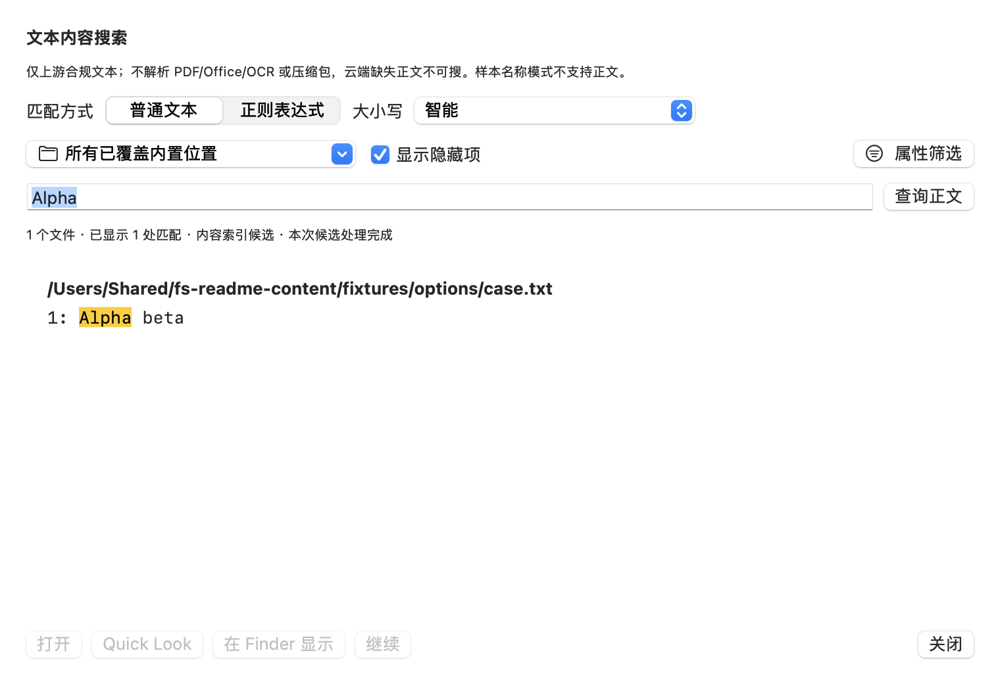

# Fsearch Desktop

一款把「找文件」这件事做快的 macOS 原生文件搜索应用。

输入一段文件名就能得到结果，选中结果即可查看属性、预览内容、打开文件，或直接跳到它在 Finder 中的位置。


> **当前版本：0.1.0，开发验证版，尚未正式发布。**
> 仓库还没有可供下载的正式安装包；默认开发包处于**样本验证模式**，只搜索内置的受控样本，不会索引你的个人磁盘。未验证项见[支持状态与已知限制](docs/product/support-status.md)。

## 主要功能

| 功能 | 说明 |
| --- | --- |
| 文件名搜索 | 默认不区分大小写的包含匹配，也可切换模糊、前缀、后缀、完整名称 |
| 范围与筛选 | 限定内置位置、个人目录或选定文件夹；按类型、扩展名、大小、修改时间筛选 |
| 结果浏览 | 按名称、索引大小、修改时间排序，支持全局排序、分页载入与隐藏项开关 |
| 检查器 | 显示路径、类型、索引大小与实际大小、创建与修改时间，可随时隐藏 |
| 快捷操作 | Quick Look 预览、打开文件、在 Finder 中显示、复制路径、面包屑跳转上级目录 |
| 文本内容搜索 | 在受控真实 Engine 模式下按普通文本或正则搜索文件正文，并高亮匹配行 |
| 本地优先 | 无账号、无远程同步；查询历史默认不保存，诊断报告由你主动导出 |

## 快速开始

**正式版**：尚未发布。发布后可从 [Releases](https://github.com/wynnok/fsearch-desktop/releases) 下载。

**开发验证版**：需要 macOS 13+ 与 Xcode 命令行工具。依赖、构建缓存和索引都留在项目目录内，不改动系统环境。

```bash
git clone https://github.com/wynnok/fsearch-desktop.git
cd fsearch-desktop
bash scripts/dev.sh run
```

`dev.sh run` 使用仓库内的受控样本启动应用，不会读取或索引你的个人文件。其他常用入口：

```bash
bash scripts/dev.sh check        # 编译与类型检查
bash scripts/dev.sh test         # 运行测试
bash scripts/package-dev-dmg.sh  # 打包开发 DMG
```

## 使用要点

在搜索框中按 Return 执行查询，结果列表支持多选、上下键与列头排序。常用操作都有原生快捷键：

| 操作 | 快捷键 |
| --- | --- |
| 聚焦搜索框 | ⌘F |
| 查询 / 刷新 | ⌘Return / ⌘R |
| 选择结果 | ↑ / ↓ |
| 打开所选文件 | Return 或双击 |
| Quick Look 预览 | Space |
| 在 Finder 中显示 | ⌘Return |
| 显示 / 隐藏检查器 | ⌥⌘I |
| 关闭预览或取消 | Escape |

权限与索引覆盖、筛选边界、文件动作、诊断导出等细节见[开发验证版使用指南](docs/product/user-guide.md)。

### 文本内容搜索

正文搜索需要明确启动受控的真实 Engine 才可用，默认样本名称模式下入口保持禁用。它只搜索上游已准入的文本文件，**不解析 PDF/Office/OCR 与压缩包**，也不会为搜索主动下载 iCloud 中尚未下载的内容。



## 已知限制

- 默认开发包只搜索受控样本，不能用它判断真实磁盘的覆盖范围、性能或完全磁盘访问权限是否生效。
- 支持目标为 macOS 13+、Apple Silicon 与 Intel，但 Intel 与 macOS 13 实机尚未验证。
- 外接盘与网络卷不在首版默认覆盖范围内；索引大小可能存在精度差异，目录大小不做递归汇总。
- 应用当前不提供移动、删除、重命名等文件管理操作。
- 开发包未经过 Developer ID 签名与公证，不要为此关闭系统安全保护。

完整支持矩阵与未验证项见[支持状态与已知限制](docs/product/support-status.md)。

## 文档

- 用户：[使用指南](docs/product/user-guide.md) · [支持状态](docs/product/support-status.md) · [产品需求](docs/product/requirements.md) · [交互方案](docs/product/interaction.md)
- 开发者：[架构方案](docs/engineering/architecture.md) · [验证计划](docs/engineering/validation-plan.md) · [发布方案](docs/engineering/release.md) · [规格索引](docs/specs/README.md) · [执行切片](docs/tickets/README.md) · [ADR](docs/adr/) · [领域术语](GLOSSARY.md)
- 协作约定：[AGENTS.md](AGENTS.md) · [Issue 跟踪](docs/agents/issue-tracker.md) · [Triage 标签](docs/agents/triage-labels.md)

## 致谢与许可

搜索与索引能力来自 [noahdunnagan/fsearch](https://github.com/noahdunnagan/fsearch)，本项目在其之上提供原生 macOS 界面与系统集成。客户端以 [MIT 许可](LICENSE) 发布，上游许可见 [bridge/FSEARCH-LICENSE](bridge/FSEARCH-LICENSE)。
