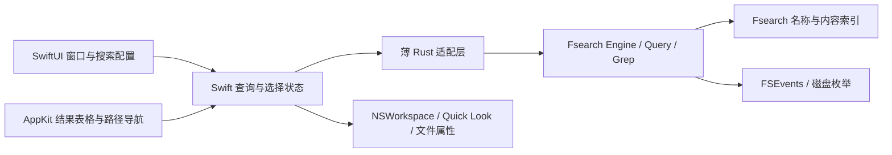

# 架构方案与集成验证

状态：用户已确认优先验证公开 Engine 嵌入路线，技术可行性尚待 M1 验证。产品边界已在 [ADR-0001](../adr/0001-native-fsearch-client.md) 确定，持续跟进上游的约束见 [ADR-0002](../adr/0002-follow-fsearch-upstream.md)，集成路线选择见 [ADR-0004](../adr/0004-validate-embedded-engine.md)。

## 分工

SwiftUI 负责窗口组合、工具栏、配置、设置与状态；AppKit 负责高密度 NSTableView、分隔面板、路径组件、系统菜单、Finder 和 Quick Look 交互。用必要的 NSViewRepresentable 边界，不为每个简单控件另做 AppKit 封装。

搜索配置/当前请求、结果集合/排序、文件选择/检查器状态分开管理：改变预览不能重新搜索，切换排序不能丢失选择，旧请求不能覆盖新请求。首次实现仅引入满足异步状态的简单模型，不建设插件系统或通用跨平台架构。

## 为什么不直接包装现有 CLI

上游 JSON socket/stdio 适合快速验证，引擎 API 也提供了结构化过滤、分页、状态和内容搜索。其名称分页 offset 路径有 MAX_FETCH=20,000，上游没有全局 sort/total，不能满足任意规模的完整结果排序。普通无 extras 请求可指定较大 limit，因此 20,000 不是所有 API 请求的绝对上限，但该路径仍不提供全局排序或完整性契约。

CLI `install` 会写入用户 bin 和 LaunchAgents；客户端不调用它，也不要求用户安装 Homebrew/Rust。CLI `stdio` 可自动启动独立 daemon，生命周期、TCC 授权主体和已有版本复用会增加产品行为的不确定性。

用户已确认优先验证以 Rust `staticlib` + 薄 C ABI 直接嵌入公开的 `fsearch::Engine`。只暴露生命周期、结构化查询、状态、结果页及释放接口；返回 Codable 可解码的数据或明确错误。索引、匹配、容错和 grep 继续使用上游函数；不复制查询评分、不读写其内部索引格式。

该集成路线已确认进入验证，尚未证明可行。当前上游 Engine 启动拥有者会维护名称和内容索引，Options 没有公开关闭内容索引的选项（[引擎调查](../research/fsearch-engine.md)）；v0.1 只有名称搜索入口不代表引擎不会读取受支持文本。用户已确认先保留上游默认机制，测量初建、峰值内存、空闲 CPU 和后台资源，并公开说明；表现不合格时优先推动上游控制选项，不能为了首版功能范围直接拆复制其内部实现。

适配层与上游依赖分开维护；每个发行版锁定上游版本，更新时替换依赖并验证桥接契约和用户行为。每日检查正式发行版，自动生成升级 PR 并执行兼容性和双架构检查；通过后由维护者合并，版本 tag 触发发行流程。用户允许必要的上游改进和可撤销的小范围临时补丁；补丁必须有来源、测试与移除条件，长期可升级性优先，不能为客户端需求逐渐复制出自有 Fsearch 实现。

若嵌入验证遇到不可控的进程内资源/退出问题，再评估 bundle 内 helper + 相同薄适配协议。这个替代方案隔离崩溃，但增加 IPC、签名及 TCC 归属验证，不能未验证就默认选用。使用 JSON 还是二进制返回格式应由数据量实测决定，不提前建设复杂 RPC。

## 全局排序和完整性

上游 `Engine::search` 可通过 Query.limit 请求更大的匹配集合，且上游有 usize::MAX 的溢出回归测试。这证明参数可接受，不证明千万文件下全量请求的内存、延迟或中文排序符合客户端需求。

推荐验证路径：

1. 关联性首屏直接使用 Fsearch 的有限 top-k，保持快速反馈；不给没有证据的精确总数。
2. 请求名称/大小/修改时间全局排序时，由适配层取得完整的本次匹配集合，再机械排序和分页。排序是呈现适配，不增加另一套匹配算法。
3. 为一次结果集合创建快照标识；后续页引用同一快照，查询/排序改变则废弃。只保留当前集合，控制内存，避免每一页重新查询和排序。
4. 结果计数注明是否完整、来自哪次索引状态。文件持续变化时，稳定快照和自动刷新各有清楚语义，不能拼接多个不同状态的页当成一份完整结果。
5. 若为了内存设置取数上限，协议必须返回 truncated，UI 必须显示“部分结果”；不能把这样的模式冒充满足 P0 全局排序。SP1 不通过则明确保留未完成需求。

大小编码已核实：小于 2 GiB 精确，达到 2 GiB 后按 2 MiB 粒度向下编码（[index.rs](https://github.com/noahdunnagan/fsearch/blob/88e63fdf850cf7749deae8198b187accd21f8ba5/src/index.rs#L1221-L1228)）。用户已接受首版筛选与排序沿用索引精度，详情按需读取实际值。严格字节边界筛选若已被上游排除，客户端只补读返回结果不能找回遗漏，后续需走上游改进。名称排序采用原生自然排序语义，需验证 Unicode/大小写/数字及稳定次序，避免桥接层与 UI 各自按不同规则排序；修改时间精度与上游一致。全局排序允许异步完成，但完整性与临时状态须准确标识。

客户端详情按需读取创建时间、所有者、权限等上游未返回字段；不把这次文件属性读取扩展成第二套搜索/索引。只为可见行缓存图标和按需属性，限制并发，快速切换选择时丢弃过期响应。

## 请求和线程规则

- 普通模式用结构化字段描述匹配方式、范围、筛选，不把任意文件名拼接成 `q` 查询语言。包含/完整名称等转成转义后的 Fsearch 正则或已有模式，实际匹配仍在 Fsearch。
- 高级模式明确解释语法；Fsearch 报错直接映射为可理解的信息，不自行改变含义。
- 空输入且无有效筛选条件时不请求全量结果，仅显示提示；单独设置有效筛选可以查询。隐藏项默认显示，系统目录不额外静默排除。
- 名称分页与内容分页分别实现：内容 cursor 是候选位置，不能当成文件数 offset。
- 引擎调用不在主线程。输入防抖，结果携带请求代次，提交 UI 前校验最新查询；取消 UI 请求并不等于上游算法立即停止。
- 过期请求必须能够丢弃；长全量请求若阻塞串行队列，需 SP1 验证可中断/独立通道或调整取数方式，不能单靠防抖宣称解决。
- C ABI 指针归属、字符串编码、panic 边界及 engine 生命周期有明确测试。不能让 Rust panic 越过 Swift FFI 边界。
- 通过上游变更通知合并刷新当前查询；新结果集合采用独立快照，按路径恢复选择和可视位置，避免把旧页拼接到新快照。刷新期间保持交互可用。
- 内容搜索保留 complete/next/source，预算耗尽允许继续。预览和匹配片段分开，元数据失败不丢弃有效路径。

## 索引、权限与生命周期

发行应用的数据目录与开发测试目录分开：开发测试必须显式使用项目内目录；真实用户应用使用 macOS Application Support。本次研究没有运行引擎对真实用户磁盘建索引。

用户已确认客户端默认使用独立索引目录，通过 `Options.dir` 与 CLI 默认目录区分（[ADR-0003](../adr/0003-isolate-client-index.md)）。目录具体名称在品牌确定后固定；保留现有 CLI 数据和进程，不擅自终止外部 daemon 或清除其索引。用户同时使用两者时接受重复索引、磁盘和 CPU 成本。owner / follower 仍是上游机制，需要验证同一客户端目录的重复实例行为，但首版不提供跨应用共享索引选项。

权限指引必须针对最终签名应用/实际扫描进程做安装后验证。上游 full_disk_access 字段是基于 skip 的状态表示，不能替代每个位置的真实可访问性测试。授权后允许重新检查及按上游机制重启/重新加载；不在客户端模拟缺失目录索引。

默认查询范围是已覆盖的内置磁盘，首次权限引导允许跳过。用户选择个人目录或指定文件夹只改变查询约束，不改变引擎扫描 root 或凭空增加授权。

优先 GitHub 直接分发。全盘搜索所需访问范围与 App Sandbox 需要实际验证，不能先把 Mac App Store 列为交付渠道。用户已确认关闭窗口后继续维护索引，⌘Q 退出应用；引擎退出能力需在 SP4 验证，不能通过关闭窗口或释放句柄就假定后台线程已停止。开机启动默认关闭，不自动安装 LaunchAgent。

每个 App 发行版固定对应的引擎依赖；兼容性验证通过后跟进上游升级，不长期冻结在当前研究基线。保留上游 MIT 和第三方依赖告知，不把内置引擎当成自研算法。最低支持目标为 macOS 13，两种芯片保持同一功能范围，尚待兼容性验证。

索引和设置本地保存；不默认持久化搜索历史。诊断仅用户主动导出，默认去除完整路径和文件内容。上游 stderr 可能包含真实路径，桥接与日志设计不能直接把它们写进用户导出的诊断包；脱敏与引擎错误呈现分别处理，不掩盖查询失败。首版检查更新提供下载链接，由用户手动安装，不动态替换已加载引擎。

## 技术验证清单

| 编号 | 要回答的问题 | 通过标准 |
| --- | --- | --- |
| SP1 | crate 集成能否满足全量名称结果、计数和三字段排序？ | 超 20,000 匹配、跨页顺序、大小精度验证、内存峰值和可取消行为有证据 |
| SP2 | bundle 内引擎和主应用的 TCC 归属？ | 正式签名安装包上受保护目录授权前后结果可解释，用户不需操作隐藏 helper |
| SP3 | Intel 原生引擎能否构建运行？ | x86_64 与 arm64 均通过查询/内容 fixture；Intel 实机测试有记录 |
| SP4 | 上游生命周期能否适合桌面应用？ | 关闭/再启动、owner/follower、持续变更、索引保存与恢复正确，空闲资源可接受 |

SP1 和 SP2 是实现 P0 前的门禁；具体步骤、样本、通过证据及失败处理见 [M1 验证计划](validation-plan.md)。计划构建、测试和发行流程见[发布方案](release.md)。

